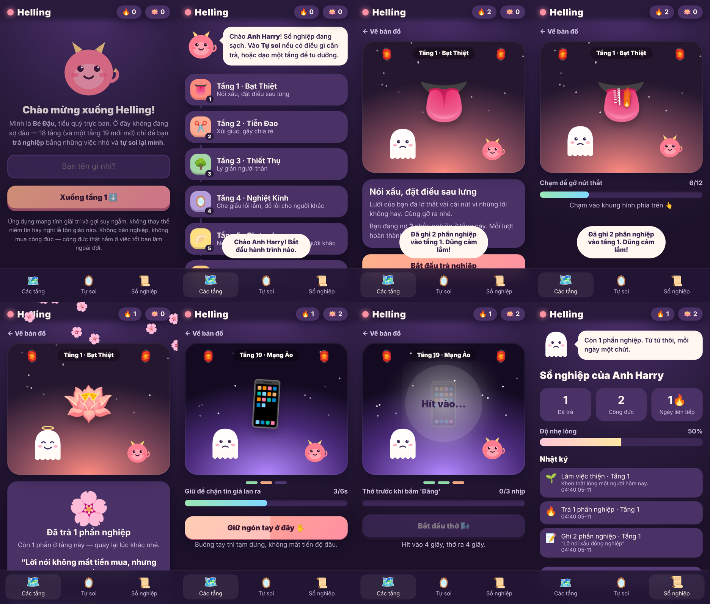
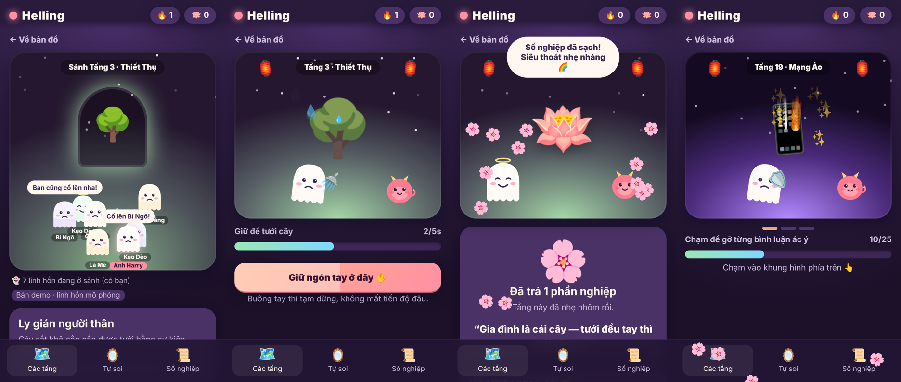

# Helling · Trả Nghiệp Online

App mobile (PWA) đi **trả nghiệp tại địa ngục online**: 18 tầng truyền thống + **Tầng 19 · Mạng Ảo** cho các "siêu tội lỗi" thời đại số.
Hoạt hoạ dễ thương, mục tiêu giải trí và tự soi lại mình — không doạ dẫm, không cợt nhả, không bán công đức.



## Sảnh mỗi tầng
Mỗi tầng có sảnh riêng: thấy linh hồn của mình (viền sáng, tên màu hồng) và các linh hồn khác đi lại, nói chuyện, đang làm việc hoặc đã có hào quang. Chạm sàn để di chuyển, chạm linh hồn khác để động viên.
> Hiện là **bản mô phỏng** (`presence.js`). Muốn có người thật, thay `Presence.join()` bằng Firebase/Supabase, giữ nguyên giao diện hàm.



## Cách chơi
1. **Tự soi** – chọn điều mình thấy chưa ổn (nói xấu, nóng giận, thất hứa…), chọn mức độ Nhẹ/Vừa/Nặng, ghi chú riêng (chỉ lưu trên máy).
2. Điều đó được ghi vào **sổ nghiệp** của tầng tương ứng (🔥).
3. Vào tầng, làm một việc nhỏ để trả nghiệp:
   - **Chạm** (gỡ nút lưỡi, giã gạo, cưa gỗ…)
   - **Giữ** (tưới cây, sưởi ấm núi băng, đẩy đá…) — buông tay chỉ tạm dừng
   - **Thở** (gương nghiệp, núi lửa hạ hỏa…) — 4 giây hít, 4 giây thở
4. Hoàn thành → nhận **một câu suy ngẫm** + **một việc thiện ngoài đời**. Đánh dấu khi đã làm thật → +2 công đức 🪷.
5. **Tầng 19** phải làm đủ 3 bước (chạm → giữ → thở), mỗi lần trả 3 phần nghiệp.

## Nhân vật
- **Bé Đậu** – tiểu quỷ trực ban tròn như hạt đậu, dẫn đường.
- **Linh hồn nhỏ** – là bạn; buồn khi còn nợ, có vầng hào quang khi nhẹ lòng.

## Chạy thử
```bash
python3 -m http.server 8000
# mở http://localhost:8000 trên điện thoại (cùng mạng) → "Thêm vào màn hình chính"
```
Không cần build, không có thư viện ngoài. Dữ liệu lưu `localStorage`, chạy offline nhờ service worker.

## Cấu trúc
| File | Nội dung |
|---|---|
| `data.js` | 19 tầng: tên, tội, câu chuyện, nhiệm vụ, bài học, việc thiện |
| `app.js` | Màn hình, mini-game, sổ nghiệp, nhân vật SVG |
| `styles.css` | Giao diện mobile-first, animation |
| `manifest.json`, `sw.js` | PWA + offline |

## Nguyên tắc nội dung
- Tên tầng lấy cảm hứng từ tín ngưỡng dân gian "Thập Bát Tầng Địa Ngục", **hình phạt được diễn giải lại** thành việc nhỏ, không bạo lực.
- Không thu tiền để "xoá nghiệp"; công đức chỉ đến từ việc tốt ngoài đời.
- Có lời nhắn hướng tới người thân / chuyên gia nếu người dùng thật sự nặng lòng.
